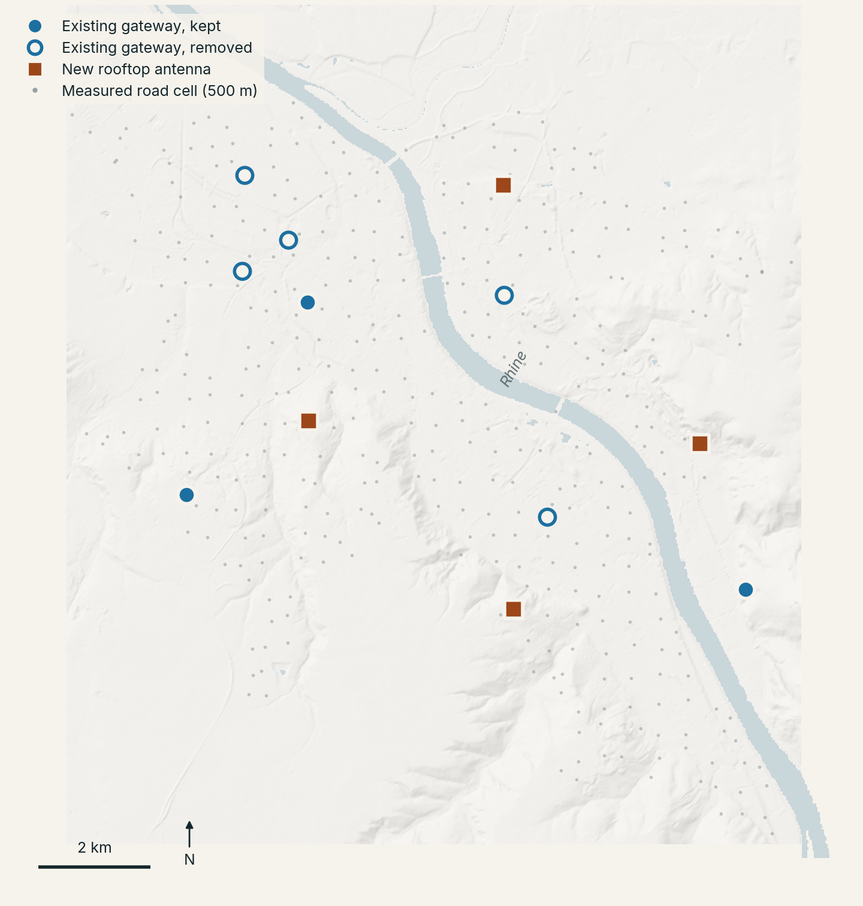
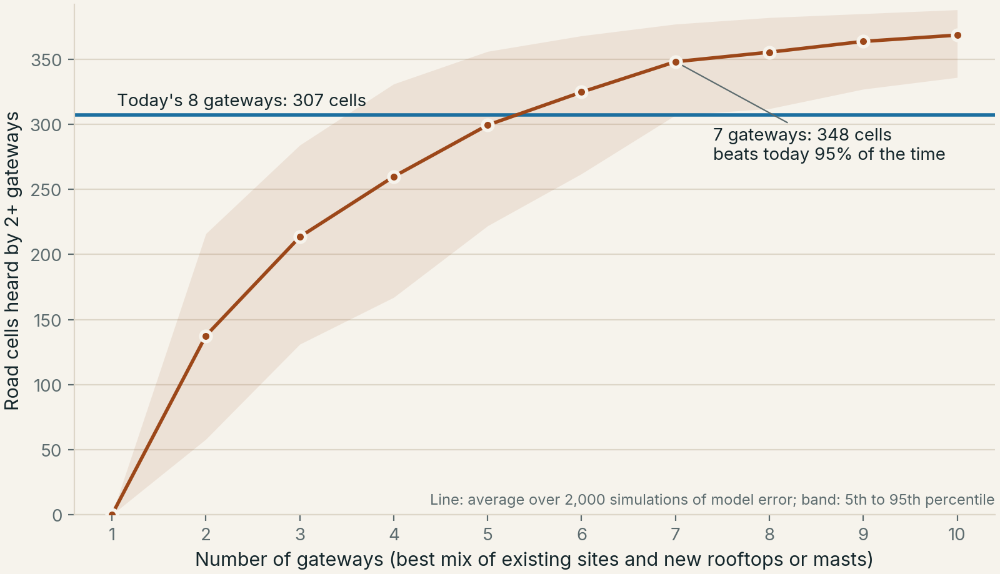

# How few gateways does a city need?

Dev Shroff and Enoch Zhu.

We trained a LightGBM coverage model on 131,057 real LoRaWAN receptions from Bonn, Germany, with features from 1 m elevation models, 3D buildings, land cover and Fresnel-zone physics. We then used an integer program to ask whether a better-placed network could beat the gateways Bonn actually built.

For basic coverage it can't, at least not by a margin the model's error can't erase. For redundancy it can. Only 71% of the measured road cells are heard by two or more of Bonn's eight gateways. **Seven gateways (three of today's eight plus four rooftop antennas) would double-cover more road cells than the existing eight with 95% probability**, once the model's measured error at unseen sites is applied: an average of 348 cells against 307, about 13% more. Bonn's gateways look sited for reach, not for resilience.





Methods, every number and the robustness checks are in [docs/results.md](docs/results.md).

## Results

| | |
|---|---|
| Reception model, unseen gateway (leave-one-gateway-out) | mean AUC 0.893, monotone LightGBM |
| Predicting a new site's footprint | precision 0.80, recall 0.71 |
| Existing 8 gateways, single coverage | 368 of 392 road cells (94%) |
| Existing 8 gateways, double coverage | 278 of 392 road cells (71%) |
| Double coverage, after model error: 7 gateways (3 existing + 4 rooftops) vs. existing 8 | 348 vs. 307 cells; better in 95% of 2,000 simulations |
| Same, new sites only | 7 sites 88%, 8 sites 94% |
| Same, with 25 m masts allowed | 6 sites, 90-91% |
| Single coverage, after model error | no robust saving; even 8 sites beat the existing network only 72-96% of the time, depending on the scenario |

The headline only counts masts that clear the surrounding tree canopy, and every chosen site was checked against aerial photos ([docs/results.md](docs/results.md) Section 3.6, photos in `results/site_audit/`).

## Method

1. Features for every device-gateway pair (`features_v2.py`): distance, antenna height, terrain and surface obstruction on a 2 m grid built from 1 m NRW DGM1/DOM1, first-Fresnel-zone clearance and knife-edge diffraction, LoD2 buildings crossed and blocking, and WorldCover 2020 foliage depth and land cover.
2. Coverage model (`models_v2.py`): LightGBM with monotone physics constraints predicts whether a gateway hears a packet. Labels are observed receptions plus inferred misses. Every gateway is held out in turn, and a separate test predicts each held-out gateway's whole footprint.
3. Candidate sites (`placement_v2.py`): the 8 existing gateways, the tallest LoD2 roof per 1 km tile, the highest bare-ground point per 2 km tile, and a 1 km grid of masts, 334 in total.
4. Coverage matrix: every candidate scored against 392 measured road cells of 500 m, for the period 2020-11-10 to 2021-01-26 when the same eight gateways were all active.
5. Optimizer (`optimize_v2.py`): exact integer programs for single (r = 1) or double (r = 2) coverage, solved with SciPy/HiGHS.
6. Error adjustment (`robustness_v2.py`): each design is re-scored 2,000 times with the error profile the model showed at real held-out gateways.
7. Robustness and site checks: mast height and forest scenarios (`placement_v2.py` options), spatially blocked validation (`spatial_cv_v2.py`), and an aerial-photo check of every chosen site (`site_audit_v2.py`).

The two planning questions are integer programs, with `a_ij = 1` when the model says a device in cell i reaches a gateway at site j:

```
A (fewest gateways):  min Σ x_j        s.t.  r·y_i ≤ Σ_j a_ij x_j,  Σ w_i y_i ≥ X·Σ w_i
B (best k gateways):  max Σ w_i y_i    s.t.  r·y_i ≤ Σ_j a_ij x_j,  Σ x_j ≤ k
                      x_j, y_i ∈ {0,1}
```

## Data

| Dataset | Role | Notes |
|---|---|---|
| [mclab-hbrs/lora-bonn](https://github.com/mclab-hbrs/lora-bonn) | Labels | GPS sensors on Bonn's garbage trucks: 131,057 receptions of 56,540 packets at 9 gateways, July 2020 to March 2021. Rademacher et al., Data licence Germany attribution 2.0. See [data/README.md](data/README.md). |
| [OpenGeodata.NRW](https://www.opengeodata.nrw.de/) | Features | 1 m DGM1/DOM1 (flown 2021-22) and LoD2 buildings; Data licence Germany zero 2.0 |
| [ESA WorldCover 2020](https://esa-worldcover.org/) | Features | 10 m land cover, CC BY 4.0 |
| OpenStreetMap | Earlier prototype | Building footprints, © OpenStreetMap contributors, ODbL |

## Running it

Python 3.12. Install the pinned packages normally, or into a local `.geo_deps` folder, which the geospatial scripts also search:

```
pip install -r requirements-bonn.txt
# or: pip install --target .geo_deps -r requirements-bonn.txt
```

Clone the Bonn survey into `data/` (commands in [data/README.md](data/README.md)), then:

```
python fetch_nrw_1m.py          # 1 m DGM/DOM tiles -> 2 m mosaics (1.2 GB)
python fetch_lod2_buildings.py  # LoD2 CityGML -> building table (streams 5 GB)
python fetch_worldcover.py      # WorldCover 2020 window
python models_v2.py             # features, ablation, footprint test (about 25 min)
python placement_v2.py          # candidates and integer programs
python robustness_v2.py         # error-adjusted coverage
python spatial_cv_v2.py         # spatially blocked validation (about 15 min)
python placement_v2.py --clear-canopy --out results/v2_sensitivity/mast15_clear_canopy
python robustness_v2.py --out results/v2_sensitivity/mast15_clear_canopy
python site_audit_v2.py         # aerial check (fetches NRW orthophotos)
python figures_v2.py            # maps and charts in results/figures/
```

Tests: `python -m unittest discover -p "test_*.py"`.

## Repository layout

- `*_v2.py` is the current pipeline. Its results are in `results/v2_*`, `results/site_audit/` and `results/figures/`; [results/README.md](results/README.md) says what each folder holds.
- `*_bonn.py`, `optimize_building_sites.py` and `render_period_comparison.py` are the first prototype (20 m rasters, OpenStreetMap candidates, a scikit-learn model). They are kept for comparison, and their results folders (`results/bonn_*`) each have a README.
- `docs/results.md` has the methods and full results.

## Limits

- Bonn's data only contains packets some gateway heard, so misses are inferred from gateways that were active that day but didn't log the packet. Reception scores are conditional on another gateway hearing the packet.
- Demand is the trucks' road network, with equal weight per 500 m cell, not population or area.
- The error adjustment uses errors measured at eight existing gateways; new rooftop and hilltop sites may behave differently, and an optimizer tends to favour sites with optimistic predictions.
- LoD2 buildings (2025-26) and the 1 m elevation models (2021-22) post-date the survey.
- Roof access, ownership and power at the chosen sites are not checked, and capacity and interference are not modelled.

## Motivation

The idea started with planning LoRa sensor networks at remote mine sites for tailings-dam monitoring. A planner that uses geometry alone (line of sight and Fresnel clearance) tends to be optimistic, so this project learns coverage from real measurements instead, in a city where open data exists.
